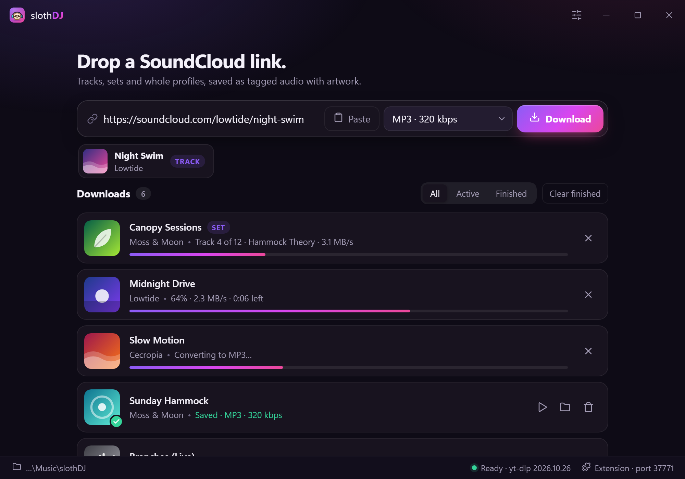
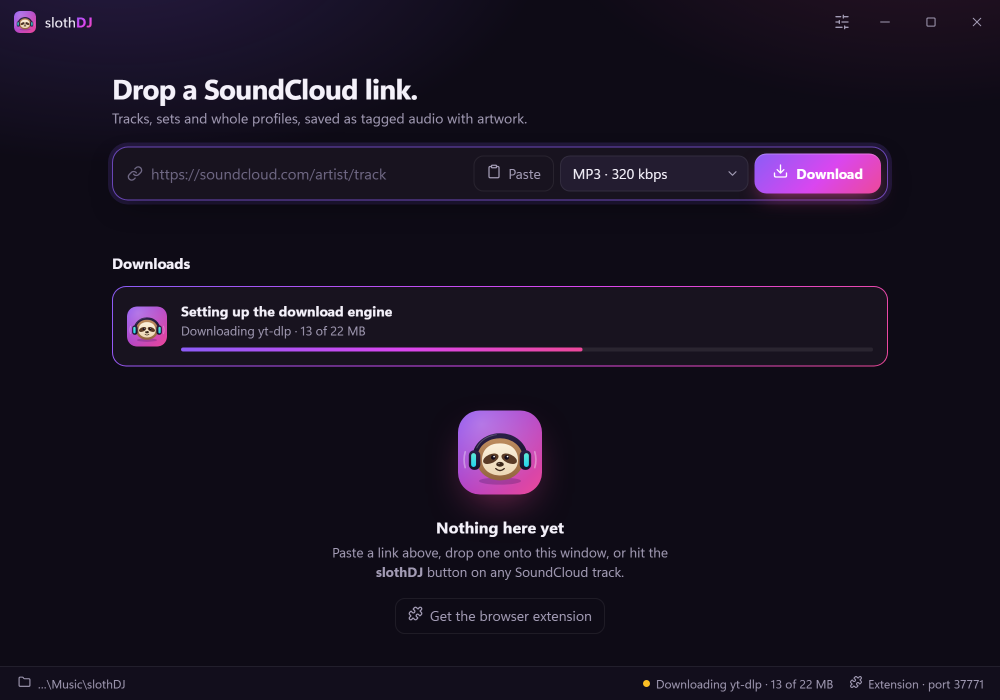
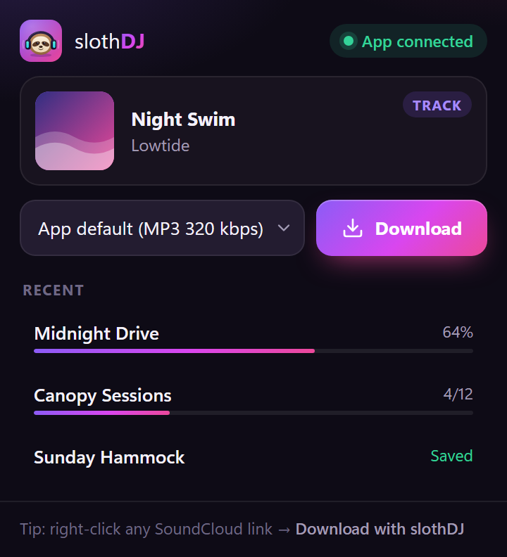
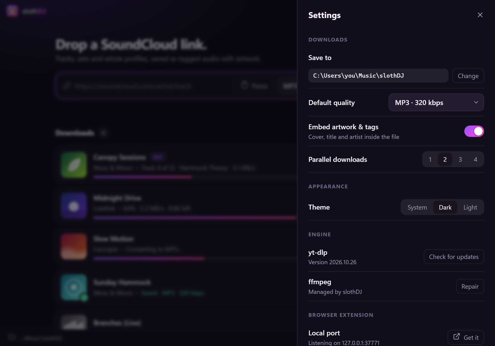
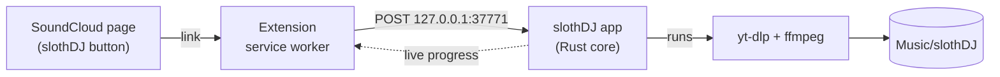

<p align="center">
  
</p>

<h1 align="center">slothDJ</h1>

<p align="center">
  <b>Slow animal. Fast downloads.</b><br>
  A tiny desktop app and browser extension that saves SoundCloud tracks, sets and whole profiles<br>
  as tagged MP3s with cover art, in one click.
</p>

<p align="center">
  <a href="https://github.com/BaraaJadaan/slothDJ/releases/latest"></a>
  <a href="https://github.com/BaraaJadaan/slothDJ/releases"></a>
  
  
  <a href="LICENSE"></a>
</p>

<p align="center">
  <a href="https://github.com/BaraaJadaan/slothDJ/releases/latest"><b>⬇ Download for Windows, macOS or Linux</b></a>
</p>

<p align="center">
  
</p>

## Why slothDJ

- **Small and quick.** The core is native Rust on Tauri, not Electron: a 2 MB installer and a 5 MB app that starts instantly. It uses the web view built into your OS instead of shipping its own copy of Chrome.
- **One click from SoundCloud.** The extension puts a slothDJ button next to Like and Share on every track, and shows live progress right on the page.
- **Tracks, sets and profiles.** Paste a playlist or an artist page and get every track, numbered, in its own folder.
- **Your quality.** MP3 at 320, 192 or 128 kbps, or the original stream with no re-encoding.
- **Tagged and tidy.** Title, artist, year and cover art are embedded. Files are named `Artist - Title.mp3`.
- **Engine that stays current.** slothDJ uses [yt-dlp](https://github.com/yt-dlp/yt-dlp) under the hood and updates it automatically, so SoundCloud changes don't break it for long.
- **Private.** Everything runs on your computer. No accounts, no tracking, no servers.
- **Nice to use.** Dark and light themes, drag a link onto the window, links on your clipboard are offered automatically, and keyboard shortcuts.

## Install

### 1. The app

Grab the file for your system from the **[latest release](https://github.com/BaraaJadaan/slothDJ/releases/latest)**:

| Platform | File |
| --- | --- |
| Windows 10 / 11 | `slothDJ_x.y.z_x64-setup.exe` (installer) or `slothDJ_x.y.z_x64_portable.exe` (no install) |
| macOS, Apple Silicon | `slothDJ_x.y.z_aarch64.dmg` |
| macOS, Intel | `slothDJ_x.y.z_x64.dmg` |
| Linux | `slothDJ_x.y.z_amd64.AppImage` or `.deb` |

On first launch slothDJ downloads its engine once: yt-dlp (about 22 MB), plus ffmpeg (about 28 MB) if it isn't already installed on your computer.

<p align="center">
  
</p>

> [!NOTE]
> The builds aren't code-signed yet.
> **Windows:** if SmartScreen shows up, click **More info → Run anyway**.
> **macOS:** right-click the app and choose **Open** the first time. If macOS says the app is damaged, run
> `xattr -dr com.apple.quarantine /Applications/slothDJ.app`.

### 2. The browser extension

Works in Chrome, Edge, Brave, Opera, Vivaldi and other Chromium browsers.

1. Download `slothDJ-extension-vX.Y.Z.zip` from the [latest release](https://github.com/BaraaJadaan/slothDJ/releases/latest) and unzip it.
2. Open `chrome://extensions` (or `edge://extensions`).
3. Turn on **Developer mode**, click **Load unpacked**, and choose the unzipped folder.
4. Pin slothDJ to your toolbar.

<p align="center">
  
</p>

## Using it

- **In the app:** paste a link (or drag one onto the window), pick a quality and press **Download**. A SoundCloud link sitting on your clipboard is offered automatically when you switch to slothDJ.
- **On SoundCloud:** click the pink slothDJ button next to Like, Repost and Share, on a track page, a set, or any track in a list. A small card shows progress and lets you cancel.
- **Anywhere:** right-click a SoundCloud link and choose **Download with slothDJ**.
- **App not running?** The extension offers to open it, and the download starts as soon as it opens.

| Shortcut | Action |
| --- | --- |
| <kbd>Ctrl</kbd>/<kbd>⌘</kbd> + <kbd>V</kbd> | Paste a link (from anywhere in the window) |
| <kbd>Enter</kbd> | Start the download |
| <kbd>Ctrl</kbd>/<kbd>⌘</kbd> + <kbd>L</kbd> | Jump to the link box |
| <kbd>Ctrl</kbd>/<kbd>⌘</kbd> + <kbd>,</kbd> | Settings |
| Double-click a finished download | Play it |

<table>
  <tr>
    <td></td>
    <td></td>
  </tr>
  <tr>
    <td align="center"><sub>Settings</sub></td>
    <td align="center"><sub>Light theme</sub></td>
  </tr>
</table>

## How it works



- The **app** (`app/`) is a Tauri 2 app. The Rust core (`app/src-tauri/src`) runs the download queue, manages the engine and serves a small local API. The UI (`app/ui`) is plain HTML, CSS and JS, with no framework and no build step.
- The **extension** (`extension/`) is a Manifest V3 extension. It never downloads anything itself. It hands links to the app over `http://127.0.0.1:37771` (or the next free port up to 37775).
- The **local API** only listens on 127.0.0.1 and accepts requests from browser extensions or local tools. Requests from websites are refused, so a web page can't make slothDJ download things.

| Method | Path | What it does |
| --- | --- | --- |
| `GET` | `/api/status` | App version, engine status, available formats |
| `POST` | `/api/download` | `{"url": "…", "format": "mp3_320"}` queues a download |
| `GET` | `/api/jobs/{id}` | Progress of one download |
| `POST` | `/api/jobs/{id}/cancel` | Cancel it |
| `POST` | `/api/show` | Bring the window to the front |

When the app is closed, the extension opens `slothdj://download?url=…`, which launches slothDJ and queues the link.

## Build from source

You need [Rust](https://rustup.rs) (stable), [Node.js](https://nodejs.org) 18 or newer, and the [Tauri prerequisites](https://tauri.app/start/prerequisites/) for your OS.

```bash
npm install
npm run dev      # run the app with hot reload
npm run build    # build installers into app/src-tauri/target/release/bundle
npm test         # Rust unit tests
```

Other scripts: `npm run icons` regenerates every icon from `brand/logo.svg`, and `npm run screenshots` re-renders the README images with demo data.

To try the extension, load the `extension/` folder unpacked (see above).

```
app/
  src-tauri/src/   Rust core: queue (jobs.rs), engine setup (engine.rs), SoundCloud links (soundcloud.rs), local API (server.rs)
  ui/              The app's interface
extension/         Browser extension (popup, background worker, SoundCloud button)
brand/             Logo source and renders
scripts/           Icon rendering and screenshot tooling
```

Releases are automatic: push a tag like `v1.1.0` and GitHub Actions builds every platform and publishes the release.

## Roadmap

- [ ] YouTube to MP3 in several qualities. The engine and the quality picker already support it; it needs a source module next to `soundcloud.rs`.
- [ ] Firefox version of the extension
- [ ] In-app updates for slothDJ itself
- [ ] Search in download history

## Responsible use

slothDJ is meant for music you're allowed to keep, such as tracks artists offer for free, Creative Commons releases, or your own uploads. Respect artists and SoundCloud's terms. slothDJ is an independent project and isn't affiliated with or endorsed by SoundCloud.

## Credits

- [yt-dlp](https://github.com/yt-dlp/yt-dlp) (Unlicense) does the extracting. slothDJ downloads the official build at runtime.
- [FFmpeg](https://ffmpeg.org) (LGPL/GPL) does the converting and tagging. Static builds come from [ffmpeg-static](https://github.com/eugeneware/ffmpeg-static), downloaded at runtime.
- [Tauri](https://tauri.app) runs the app shell. Icons are from [Lucide](https://lucide.dev) (ISC).

## License

[MIT](LICENSE) © 2026 Baraa Jadaan
