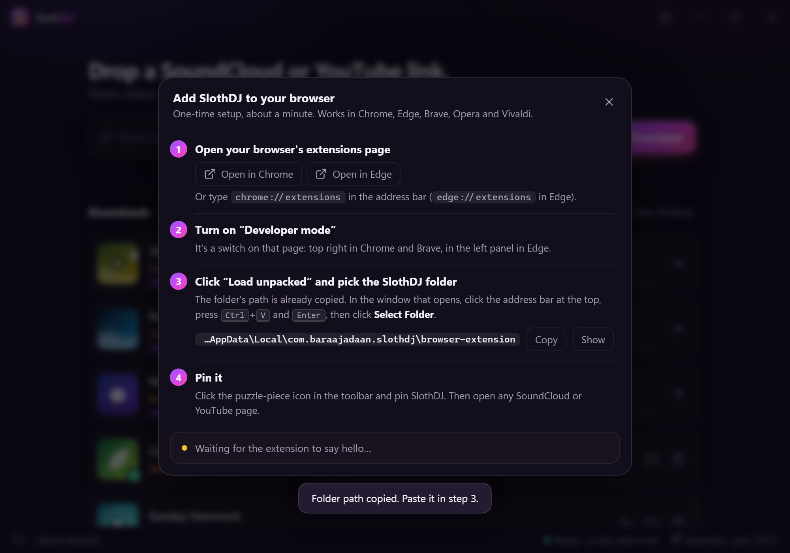
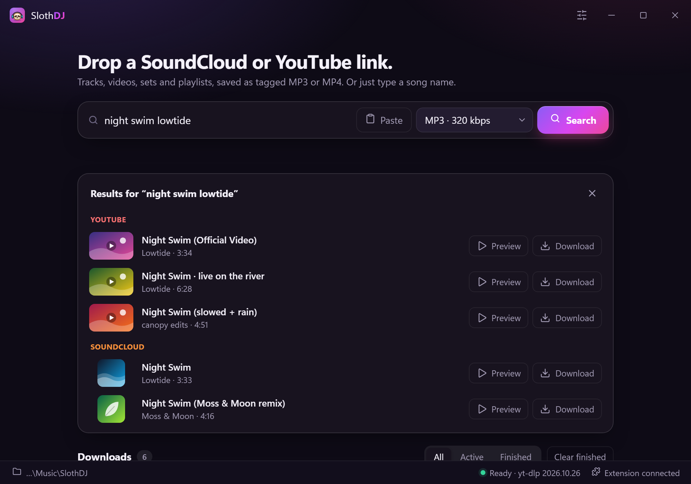
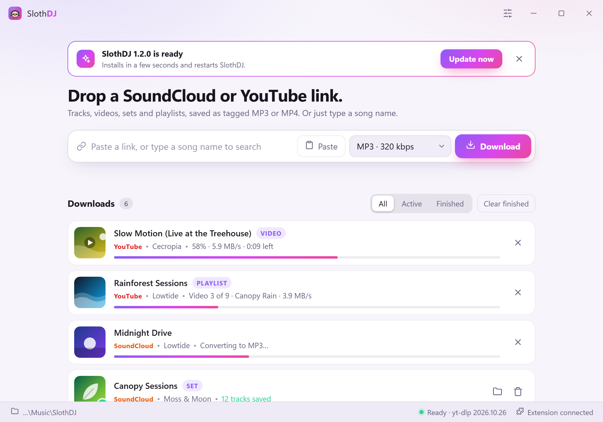
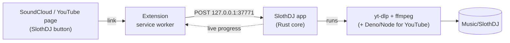

<p align="center">
  
</p>

<h1 align="center">SlothDJ</h1>

<p align="center">
  <b>Slow animal. Fast downloads.</b><br>
  A tiny desktop app and browser extension that saves SoundCloud and YouTube<br>
  as tagged MP3s with cover art, or as MP4 video, in one click.
</p>

<p align="center">
  <a href="https://github.com/BaraaJadaan/slothDJ/releases/latest"></a>
  <a href="https://github.com/BaraaJadaan/slothDJ/releases"></a>
  
  
  <a href="LICENSE"></a>
</p>

<p align="center">
  <a href="https://github.com/BaraaJadaan/slothDJ/releases/latest"><b>⬇ Download for Windows, macOS or Linux</b></a>
</p>

<p align="center">
  
</p>

## Why SlothDJ

- **Small and quick.** The core is native Rust on Tauri, not Electron: a 2 MB installer and a small app that starts instantly. It uses the web view built into your OS instead of shipping its own copy of Chrome.
- **SoundCloud and YouTube.** Tracks, sets and whole profiles from SoundCloud; videos, Shorts, YouTube Music and playlists from YouTube.
- **MP3 or video.** MP3 at 320, 192 or 128 kbps, the original audio with no re-encoding, or MP4 video at 480p, 720p, 1080p or the best available (up to 4K).
- **Search by name.** No link? Type a song or artist and pick from SoundCloud and YouTube results.
- **Preview first.** Listen to a SoundCloud track or watch a YouTube video inside the app before deciding to download it.
- **One click from your browser.** The extension adds a SlothDJ button on SoundCloud tracks and under YouTube videos, with live progress right on the page.
- **Tagged and tidy.** Title, artist, year and square cover art are embedded. Files are named `Artist - Title.mp3`, and YouTube clutter like "(Official Video)" is dropped from names.
- **Always ready.** SlothDJ keeps running in the tray when you close the window, can start with your computer, and notifies you when downloads finish.
- **Updates itself.** New versions install in one click from inside the app. The download engine ([yt-dlp](https://github.com/yt-dlp/yt-dlp)) also keeps itself current, so site changes don't break it for long.
- **Private.** Everything runs on your computer. No accounts, no tracking, no servers.

## Install

### 1. The app

Grab the file for your system from the **[latest release](https://github.com/BaraaJadaan/slothDJ/releases/latest)**:

| Platform | File |
| --- | --- |
| Windows 10 / 11 | `SlothDJ_x.y.z_x64-setup.exe` (installer) or `SlothDJ_x.y.z_x64_portable.exe` (no install) |
| macOS, Apple Silicon | `SlothDJ_x.y.z_aarch64.dmg` |
| macOS, Intel | `SlothDJ_x.y.z_x64.dmg` |
| Linux | `SlothDJ_x.y.z_amd64.AppImage` or `.deb` |

From v1.1.0 on, SlothDJ updates itself: when a new version is out, a banner offers to install it.

On first launch SlothDJ downloads its engine once: yt-dlp (about 22 MB), plus ffmpeg (about 28 MB) if it isn't already installed. YouTube also needs a small JavaScript engine: SlothDJ uses Node.js or Deno if you have one, and otherwise downloads Deno (about 40 MB) the first time you download from YouTube.

<p align="center">
  
</p>

> [!NOTE]
> The builds aren't code-signed yet.
> **Windows:** if SmartScreen shows up, click **More info → Run anyway**.
> **macOS:** right-click the app and choose **Open** the first time. If macOS says the app is damaged, run
> `xattr -dr com.apple.quarantine /Applications/SlothDJ.app`.

### 2. The browser extension

Works in Chrome, Edge, Brave, Opera, Vivaldi and other Chromium browsers. The extension comes inside the app, and the app walks you through adding it:

1. In SlothDJ, click **Add the browser extension** on the start screen (or **Settings → Browser extension → Set up**).
2. Click **Open in Chrome** (or Edge, Brave…) to open your browser's extensions page.
3. Turn on **Developer mode**.
4. Click **Load unpacked**. SlothDJ has already copied the folder's path: click the address bar at the top of the window that opens, press <kbd>Ctrl</kbd>+<kbd>V</kbd> and <kbd>Enter</kbd>, then **Select Folder**.
5. Pin SlothDJ to your toolbar. The guide turns green as soon as the extension says hello.

SlothDJ keeps that folder up to date when the app updates, so the extension updates with it (your browser picks up the new version the next time it starts). Once the extension is connected, the app stops suggesting it.

<p align="center">
  
</p>

<details>
<summary>Prefer doing it by hand?</summary>

1. Download `SlothDJ-extension-vX.Y.Z.zip` from the [latest release](https://github.com/BaraaJadaan/slothDJ/releases/latest) and unzip it into a folder you'll keep, for example `C:\SlothDJ-extension`. The browser loads the extension from that folder every time, so don't delete it.
2. Open `chrome://extensions` (or `edge://extensions`), turn on **Developer mode**, click **Load unpacked**, and choose the unzipped folder.
3. To update later, unzip the new version over the same folder and click the reload icon on its card.

</details>

<p align="center">
  
</p>

## Using it

- **Paste a link:** paste or drag a SoundCloud or YouTube link onto the window, pick a quality and press **Download**. A link sitting on your clipboard is offered automatically when you switch to SlothDJ.
- **Search:** type a song or artist instead and press **Enter**. Results from YouTube and SoundCloud appear; click **Preview** to listen or watch first, or **Download** on the one you want. A pasted link gets a **Preview** button too.
- **Removing downloads:** the trash button asks whether to remove the entry from the list only or delete the file too (deleted files go to the Recycle Bin or Trash). Tick **Remember my choice**, or set the default in **Settings → Remove button**.
- **On SoundCloud:** on a track or set page, click **SlothDJ** next to Like, Repost and Share. Every track in a list gets a small SlothDJ button too.
- **On YouTube:** click **SlothDJ** under the video, next to Like and Share.
- **Choosing the quality from the browser:** the SlothDJ button shows the quality it will use (for example *MP3 320*). Click its **▾** to download as something else: MP3 320/192/128 or the original audio, and on YouTube also MP4 video up to 4K. Your pick is remembered separately for SoundCloud and YouTube, and the extension's toolbar popup uses the same setting.
- **Right-click:** on any SoundCloud link choose **Download with SlothDJ**; on YouTube links choose **Download audio (MP3)** or **Download video (MP4)**.
- **App not open?** The extension offers to open it, and the download starts as soon as it does.

<p align="center">
  
</p>

| Shortcut | Action |
| --- | --- |
| <kbd>Ctrl</kbd>/<kbd>⌘</kbd> + <kbd>V</kbd> | Paste a link (from anywhere in the window) |
| <kbd>Enter</kbd> | Download the link, or search for the words you typed |
| <kbd>Ctrl</kbd>/<kbd>⌘</kbd> + <kbd>L</kbd> | Jump to the link box |
| <kbd>Ctrl</kbd>/<kbd>⌘</kbd> + <kbd>,</kbd> | Settings |
| <kbd>Esc</kbd> | Close a preview, search results or Settings |
| Double-click a finished download | Play it |

<table>
  <tr>
    <td></td>
    <td></td>
  </tr>
  <tr>
    <td align="center"><sub>Settings</sub></td>
    <td align="center"><sub>Light theme, with an update ready</sub></td>
  </tr>
</table>

## How it works



- The **app** (`app/`) is a Tauri 2 app. The Rust core (`app/src-tauri/src`) runs the download queue, manages the engine, searches, and serves a small local API. The UI (`app/ui`) is plain HTML, CSS and JS, with no framework and no build step.
- **Sites** live in their own modules: `soundcloud.rs` and `youtube.rs` turn a pasted link into a canonical one with a quick preview, and `sources.rs` routes between them. Adding another site means adding one more module.
- The **extension** (`extension/`) is a Manifest V3 extension. It never downloads anything itself. It hands links to the app over `http://127.0.0.1:37771` (or the next free port up to 37775).
- The **local API** only listens on 127.0.0.1 and accepts requests from browser extensions or local tools. Requests from websites are refused, so a web page can't make SlothDJ download things.

| Method | Path | What it does |
| --- | --- | --- |
| `GET` | `/api/status` | App version, engine status, available formats |
| `POST` | `/api/download` | `{"url": "…", "format": "mp3_320"}` queues a download (`mp4_1080` etc. for YouTube video) |
| `GET` | `/api/jobs/{id}` | Progress of one download |
| `POST` | `/api/jobs/{id}/cancel` | Cancel it |
| `POST` | `/api/show` | Bring the window to the front |

When the app is closed, the extension opens `slothdj://download?url=…`, which launches SlothDJ and queues the link.

## Build from source

You need [Rust](https://rustup.rs) (stable), [Node.js](https://nodejs.org) 18 or newer, and the [Tauri prerequisites](https://tauri.app/start/prerequisites/) for your OS.

```bash
npm install
npm run dev      # run the app with hot reload
npm run build    # build installers into app/src-tauri/target/release/bundle
npm test         # Rust unit tests
```

Other scripts: `npm run icons` regenerates every icon from `brand/logo.svg`, and `npm run screenshots` re-renders the README images with demo data.

To try the extension, load the `extension/` folder unpacked (see above).

```
app/
  src-tauri/src/   Rust core: queue (jobs.rs), engine (engine.rs), sites (soundcloud.rs, youtube.rs),
                   search (search.rs), local API (server.rs), tray and updates (main.rs)
  ui/              The app's interface
extension/         Browser extension (popup, background worker, page buttons for SoundCloud and YouTube)
brand/             Logo source and renders
scripts/           Icon rendering and screenshot tooling
```

### Releases

Push a tag like `v1.2.0` and GitHub Actions builds every platform and publishes the release, including the signed `latest.json` the in-app updater reads. Update files are signed with a private key kept in the repository secret `TAURI_SIGNING_PRIVATE_KEY`; its public half is in `app/src-tauri/tauri.conf.json`. Local builds don't need the key.

## Roadmap

- [ ] Firefox version of the extension
- [ ] Search in download history
- [ ] More sites (Bandcamp, Mixcloud)
- [ ] Extension in the Chrome Web Store and Edge Add-ons for one-click install

## Responsible use

SlothDJ is meant for media you're allowed to keep, such as music artists offer for free, Creative Commons works, or your own uploads. Respect creators and each site's terms. SlothDJ is an independent project and isn't affiliated with or endorsed by SoundCloud or YouTube.

## Credits

- [yt-dlp](https://github.com/yt-dlp/yt-dlp) (Unlicense) does the extracting. SlothDJ downloads the official build at runtime.
- [FFmpeg](https://ffmpeg.org) (LGPL/GPL) does the converting and tagging. Static builds come from [ffmpeg-static](https://github.com/eugeneware/ffmpeg-static), downloaded at runtime.
- [Deno](https://deno.com) (MIT) runs YouTube's player scripts for yt-dlp when Node.js isn't installed. Downloaded at runtime.
- [Tauri](https://tauri.app) runs the app shell. Icons are from [Lucide](https://lucide.dev) (ISC).

## License

[MIT](LICENSE) © 2026 Baraa Jadaan
